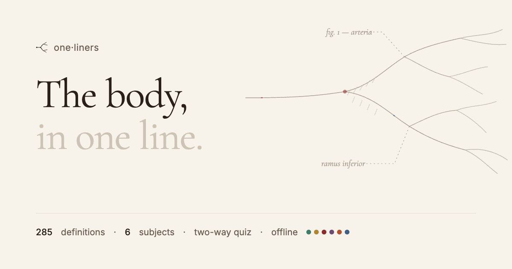
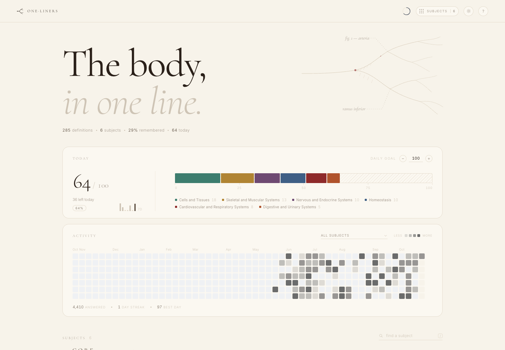
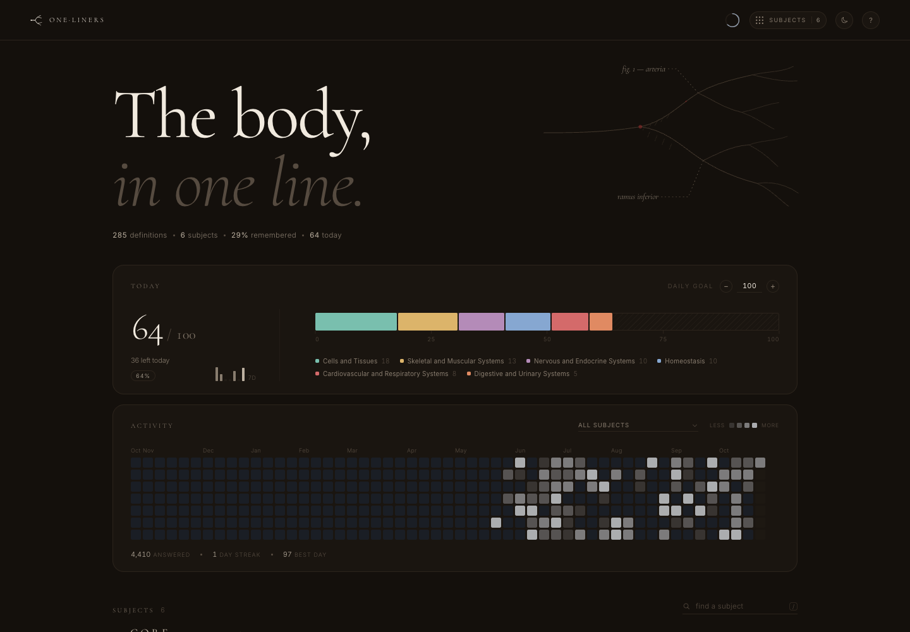
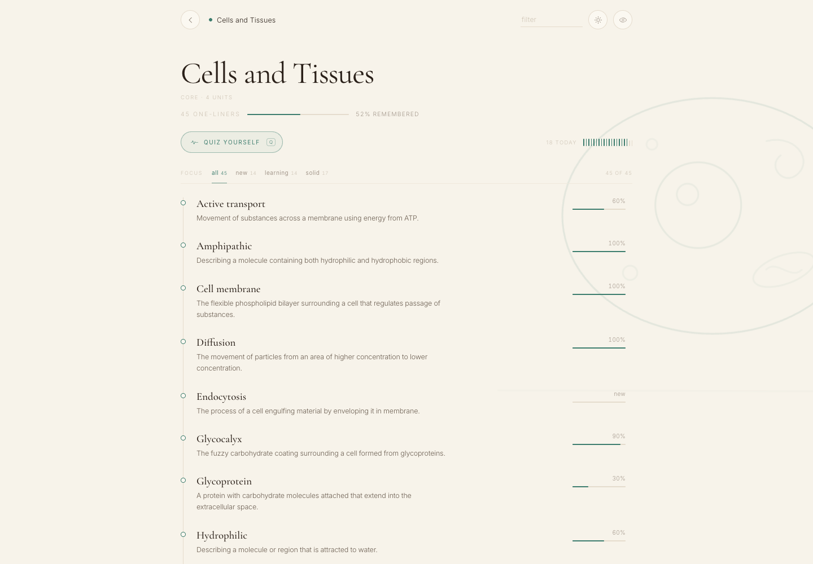
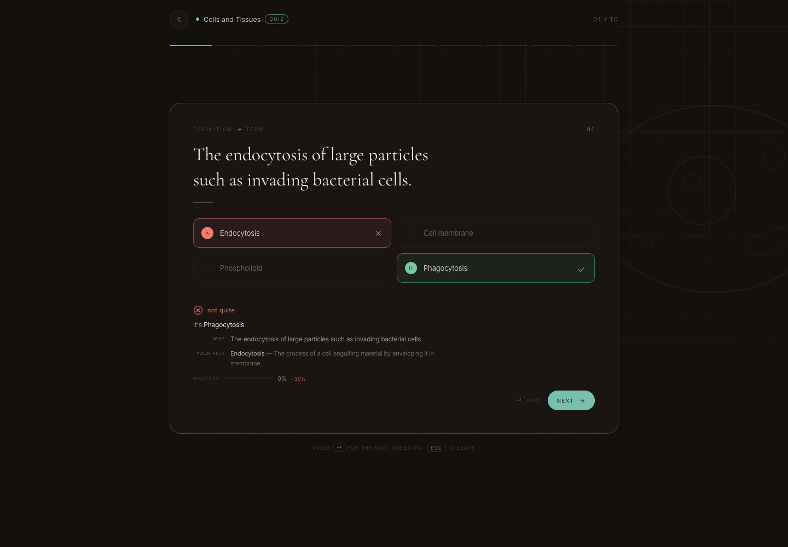
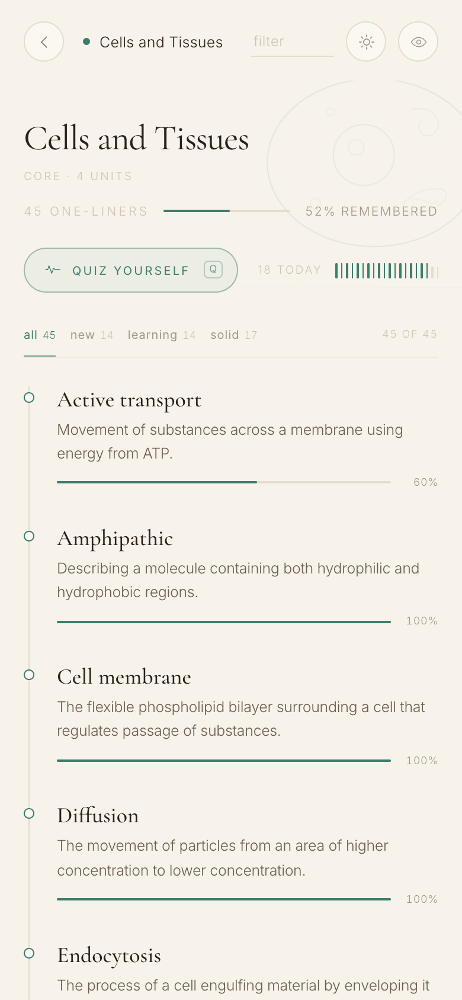

<div align="center">
  
</div>

<div align="center">

# one·liners · Anatomy & Physiology

**Anatomy and physiology, in one line.**

A quiet anatomical atlas you can practise: 285 definitions across 6 subjects — cells and tissues, bones and muscle, heart and lungs, nerves and hormones, digestion and the kidneys, and homeostasis — with an adaptive two-way quiz and a memory of what you know.

<a href="https://abhinav-prabhakar.github.io/AnatomyDefinitions/">
  
</a>

<br /><br />


</div>

<p align="center"><sub>Screenshots use sample study data. The app itself starts clean, on your device.</sub></p>

---

## Why this exists

Anatomy is a language before it is a body. *Epiphysis*, *cardiac output*, *glial cell*, *negative feedback* — every one is a single sentence, and every exam assumes you have hundreds of them ready. **one·liners** gives each term one line, quizzes it both ways, and keeps returning the ones that slip.

Parchment paper, sepia ink, an old-atlas serif with italic figure labels, and a branching vessel drawn like an engraving. Each system has its own pigment. No accounts, no server, no noise.

> **Recognition is not recall.** Spotting *epiphysis* on a diagram is not the same as naming it from its description. So the quiz asks both ways.

---

## Screenshots

<table>
  <tr>
    <td width="50%">
      
      <p align="center"><sub><strong>Light by default</strong> · today, activity, subject mastery</sub></p>
    </td>
    <td width="50%">
      
      <p align="center"><sub><strong>Dark when you choose it</strong> · remembered across visits</sub></p>
    </td>
  </tr>
</table>

<table>
  <tr>
    <td width="58%">
      
      <p align="center"><sub><strong>Every definition has a memory.</strong> Hover a row for its mastery and source.</sub></p>
    </td>
    <td width="42%">
      
      <p align="center"><sub><strong>Answers explain themselves.</strong> The definition, and what you picked.</sub></p>
    </td>
  </tr>
</table>

<div align="center">
  
  <p><sub><strong>320 → 1440px.</strong> The same quiet interface, not a crushed desktop.</sub></p>
</div>

---

## What's inside

**285 one-liners** across **6 subjects**, written for pre-health and allied-health students.

- **Core** — Cells and Tissues, Skeletal and Muscular Systems, Cardiovascular and Respiratory Systems, Nervous and Endocrine Systems, Digestive and Urinary Systems, Homeostasis

| Subject | Definitions | Units |
| --- | ---: | --- |
| **Cells and Tissues** | 45 | Cell structure · Cell division · Tissues · Membranes and glands |
| **Skeletal and Muscular Systems** | 50 | Bone structure · Axial skeleton · Appendicular skeleton · Muscle types · Muscle contraction |
| **Cardiovascular and Respiratory Systems** | 55 | Heart · Blood vessels · Blood · Respiratory tract · Gas exchange |
| **Nervous and Endocrine Systems** | 50 | Neuron and nerve · Brain and spinal cord · Senses · Endocrine glands · Hormones |
| **Digestive and Urinary Systems** | 45 | Digestive tract · Accessory organs · Urinary tract · Fluid balance |
| **Homeostasis** | 40 | Feedback loops · Temperature regulation · pH and buffers · Osmoregulation |

Every definition is one sentence, 8–28 words, and carries a source locator. Hover a
definition's mastery rail to see where it came from. Coverage, gaps and assumptions are
documented in [`data/README.md`](data/README.md).

---

## Two directions of recall

Every round mixes both question types, balanced 5/5. You cannot coast on recognition.

| Prompt | You choose | What it trains |
| --- | --- | --- |
| `Cardiac output` | one of four definitions | term → meaning |
| “Wide section at each end of a long bone, filled with spongy bone and red marrow.” | one of four terms | meaning → term |

- **The term is never in the question.** When a definition has to mention its own term, the
  quiz blanks it out, so meaning → term tests meaning.
- **Wrong answers that look right.** Distractors come from each definition's curated
  look-alikes, then from similar wording in the same unit — never four random strangers.
- **Adaptive sampling.** The three weakest definitions are guaranteed a slot; the rest are
  weighted toward low mastery.
- **Keyboard complete.** <kbd>1</kbd>–<kbd>4</kbd> or <kbd>A</kbd>–<kbd>D</kbd> to choose,
  <kbd>Enter</kbd> for next, <kbd>Esc</kbd> to leave, <kbd>r</kbd> to repeat a round.

---

## A memory you can see

Mastery is one confidence score per definition, stored locally: **+30%** for a correct answer,
**−40%** for a miss. Four clean answers reach 100%.

| After | Score | Reads as |
| --- | --- | --- |
| no attempts | 0% | `new` |
| 1 correct | 30% | `learning` |
| 2 correct | 60% | `familiar` |
| 3 correct | 90% | `solid` |
| a miss | −40% | re-learn |

The subject page shows a 2px bar on every definition; cards show a bar profile of the whole
subject; the home page has a daily goal stack and a quiet, monochrome activity trail.

---

## Offline, installable, private

- **Full PWA** — manifest, service worker, maskable icons. Works offline after the first load.
  Install from the browser's own menu (Chrome: the install icon in the address bar; iOS Safari:
  **Share → Add to Home Screen**; macOS Safari: **File → Add to Dock**).
- **No accounts, no analytics, no server.** Progress lives in `localStorage` under
  `oneliners.anatomy-and-physiology.*` and never leaves the device.
- **Self-hosted type** — Cormorant Garamond, Inter. No external font requests.
- **Light by default**, dark when you choose it, remembered before first paint.

---

## Sources

| Source | Publisher | License |
| --- | --- | --- |
| [Anatomy and Physiology 2e](https://openstax.org/books/anatomy-and-physiology-2e) | OpenStax (Rice University) | CC BY-NC-SA 4.0 |

Definitions are paraphrased one-liners, not excerpts. Raw source material is not redistributed.

---

## Run it locally

```bash
# A server is required: the app fetches its data.
python3 -m http.server 8000
# → http://localhost:8000/
```

No build step, no dependencies. `index.html` is the whole app.

```text
.
├── index.html             # the entire app
├── manifest.webmanifest   # PWA manifest
├── sw.js                  # offline app shell + data cache
├── data/
│   ├── curriculum.json    # sections and subjects the app loads
│   ├── sources.json       # where every definition comes from
│   ├── collection.json    # scope, audience, assumptions
│   ├── README.md          # coverage report
│   └── subjects/*.json    # one file per subject
└── assets/                # icons, social card, screenshots, fonts
```

---

## The one·liners family

Same instrument, different vocabularies. Each has its own look, data and progress.

| Collection | Repository |
| --- | --- |
| [Electronics, in one line.](https://abhinav-prabhakar.github.io/ECEDefinitions/) | [`Abhinav-Prabhakar/ECEDefinitions`](https://github.com/Abhinav-Prabhakar/ECEDefinitions) |
| **[Anatomy and physiology, in one line.](https://abhinav-prabhakar.github.io/AnatomyDefinitions/)** | [`Abhinav-Prabhakar/AnatomyDefinitions`](https://github.com/Abhinav-Prabhakar/AnatomyDefinitions) |
| [Electricity, in one line.](https://abhinav-prabhakar.github.io/ElectricalCodeDefinitions/) | [`Abhinav-Prabhakar/ElectricalCodeDefinitions`](https://github.com/Abhinav-Prabhakar/ElectricalCodeDefinitions) |
| [HVAC, in one line.](https://abhinav-prabhakar.github.io/HVACDefinitions/) | [`Abhinav-Prabhakar/HVACDefinitions`](https://github.com/Abhinav-Prabhakar/HVACDefinitions) |
| [Medicine, in one line.](https://abhinav-prabhakar.github.io/MedicalTerminologyDefinitions/) | [`Abhinav-Prabhakar/MedicalTerminologyDefinitions`](https://github.com/Abhinav-Prabhakar/MedicalTerminologyDefinitions) |
| [Nursing, in one line.](https://abhinav-prabhakar.github.io/NursingDefinitions/) | [`Abhinav-Prabhakar/NursingDefinitions`](https://github.com/Abhinav-Prabhakar/NursingDefinitions) |
| [Pharmacology, in one line.](https://abhinav-prabhakar.github.io/PharmacologyDefinitions/) | [`Abhinav-Prabhakar/PharmacologyDefinitions`](https://github.com/Abhinav-Prabhakar/PharmacologyDefinitions) |
| [Plumbing, in one line.](https://abhinav-prabhakar.github.io/PlumbingDefinitions/) | [`Abhinav-Prabhakar/PlumbingDefinitions`](https://github.com/Abhinav-Prabhakar/PlumbingDefinitions) |
| [Software, in one line.](https://abhinav-prabhakar.github.io/SoftwareInterviewDefinitions/) | [`Abhinav-Prabhakar/SoftwareInterviewDefinitions`](https://github.com/Abhinav-Prabhakar/SoftwareInterviewDefinitions) |
| [The law, in one line.](https://abhinav-prabhakar.github.io/LegalDefinitions/) | [`Abhinav-Prabhakar/LegalDefinitions`](https://github.com/Abhinav-Prabhakar/LegalDefinitions) |

### Credits

Definitions are paraphrased from the openly licensed anatomy texts listed above. Built on the [one·liners](https://github.com/Abhinav-Prabhakar/ECEDefinitions) engine. Fonts: Cormorant Garamond, Inter (SIL Open Font License 1.1).

<div align="center">
  <sub>If this helps you through A&P, star the repo. It keeps the atlas growing.</sub>
</div>
